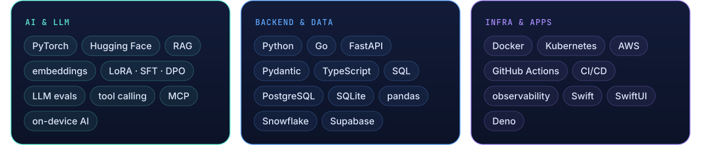

  &nbsp;
  &nbsp;
  

## Hi, I'm Pavan 👋

I'm an **Applied AI Engineer** who likes the unglamorous half of AI: the retrieval layer that decides what a model gets to see, the eval that catches a regression before a user does, the permission check in front of every tool call, and the runtime that survives a crash at the worst possible moment.

I came to this from the data side. I'm currently at **Fidelity Investments**, and before that I worked on biomedical **NLP** at **Affinia Therapeutics** and data engineering at **Cognizant**. Real data and real users taught me that the model is rarely the part that breaks. Everything around it is.

- 🔭 **Focus:** LLM applications, retrieval-augmented generation (RAG), LLM evaluation, AI agent platforms, reliable inference
- 🧑‍💻 **Languages:** Python every day, plus Go, Swift, SQL and TypeScript
- 🎓 **Education:** M.S. in Data Science, Northeastern University · doctoral student, University of the Cumberlands
- 📱 **Building:** Turtledove, an iPhone app for couples (closed beta)
- 💼 **Open to:** Applied AI, LLM platform and ML infrastructure roles

## 🕊️ Building now: Turtledove

Turtledove is a shared-life app for couples: plans, trips, habits you keep together and a shared journal, in one place for two. I'm designing and building it solo, end to end.

- **iOS:** native SwiftUI with SwiftData, WidgetKit widgets, App Intents for Siri and Shortcuts, and on-device Apple Intelligence for search and spelling, so nothing personal leaves the phone
- **Backend:** Supabase with Postgres row-level security, transactional pairing, Deno edge functions and a push notification worker
- **AI integration:** a remote MCP server (32 tools, OAuth 2.1) so assistants like ChatGPT and Claude can read and add plans, with every connection approved on your iPhone
- **Status:** closed beta on TestFlight. The code is private for now, and I'm happy to walk through it in an interview.

## 🧪 Selected work

Each project starts from a failure mode that bites real AI systems, and ships with code, tests and an honest write-up of what the experiments show (and what they don't).

  
  
  
  
  
  
  
  

### More from the lab

| Area | Project | What it explores |
| --- | --- | --- |
| LLM systems | [model-router](https://github.com/pavan139/model-router) | Learned routing between cheaper and stronger models under a budget, with held-out evaluation and calibration |
| LLM systems | [constrained-generation](https://github.com/pavan139/constrained-generation) | Grammar-constrained decoding with incremental parsing, token masks and bounded interpreters |
| Agents | [agent-arena](https://github.com/pavan139/agent-arena) | D* Lite incremental replanning for bounded agents with typed tools |
| Vision + ML | [pixel-to-program](https://github.com/pavan139/pixel-to-program) | An encoder-decoder that reads an image and writes the program that draws it |
| MLOps | [drift-sentinel](https://github.com/pavan139/drift-sentinel) | Sequential drift monitoring with delayed labels and a real alert lifecycle |
| MLOps | [model-ledger](https://github.com/pavan139/model-ledger) | Content-addressed model registry with lineage, compare-and-swap promotions and rollback |
| MLOps | [chronofeature](https://github.com/pavan139/chronofeature) | Point-in-time feature store that keeps future data out of training, with offline/online parity |
| Data systems | [eventflow](https://github.com/pavan139/eventflow) | Event-time stream processing: watermarks, retractions, checkpoints and deterministic recovery |
| Data systems | [incremental-lakehouse](https://github.com/pavan139/incremental-lakehouse) | Incremental CDC warehouse with schema contracts, lineage and atomic publish |
| Data systems | [query-forge](https://github.com/pavan139/query-forge) | A small SQL engine: parser, relational plans and join optimization, checked against SQLite |
| Distributed systems | [quorum-lab](https://github.com/pavan139/quorum-lab) | Durable Raft in Go under network partitions and restarts, with a safety checker |

## 🧭 How I think about AI systems

| When I look at... | ...I want to know |
| --- | --- |
| **Retrieval** | Is the evidence relevant, permitted, current and sufficient? Can the system say "I don't know"? |
| **Evaluation** | What is the independent oracle? Which cases fail? Would the release gate have caught last month's regression? |
| **Agent safety** | Who authorizes a tool's side effects? Can a request exceed its scope or replay a committed action? |
| **Reliability** | What happens after a timeout, a duplicate delivery, a stale lease or a crash between two commits? |
| **Performance** | What workload was measured, and what does the latency or cost number actually include? |

## 🧰 Toolbox

## 🌱 Off the keyboard

- 📚 Doctoral student at the University of the Cumberlands. My research interest: how LLMs actually change everyday work.
- 🏔️ Happiest on a road trip with a national park at the end of it.
- 🏃 Slowly, stubbornly training for a 5K.
- ✍️ I write READMEs the way I like to read them: what broke, what I tried, and what the numbers actually say.

