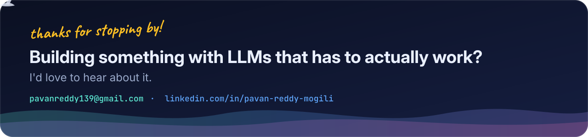

  &nbsp;
  &nbsp;
  

## Hi, I'm Pavan 👋

I'm a **Senior Data Scientist at Fidelity Investments**, and I build the reliability layer around LLMs: the retrieval that decides what a model gets to see, the evals that catch a regression before users do, the permission check in front of every tool call, and the runtime that survives a crash at the worst possible moment.

I've worked with real data since 2019: software and data engineering at **Cognizant**, machine learning on biomedical text at **Affinia Therapeutics**, and an **M.S. in Data Science at Northeastern University**, where I also TA'd AI/ML and deep learning. The lesson that stuck with me is that the model is rarely the part that breaks. Everything around it is. That's the part I build, test, and write up honestly, including when the numbers are unflattering.

**Open to Applied AI, LLM platform and ML infrastructure roles.** The quickest way to reach me is [email](mailto:pavanreddy139@gmail.com) or [LinkedIn](https://www.linkedin.com/in/pavan-reddy-mogili/).

## Building now: Turtledove

Designed and built solo, end to end:

- **iOS:** native SwiftUI with SwiftData, WidgetKit, App Intents for Siri and Shortcuts, and on-device Apple Intelligence for search and spelling, so nothing personal leaves the phone
- **Backend:** Supabase with Postgres row-level security, transactional pairing, Deno edge functions and a push notification worker
- **AI integration:** a remote MCP server (32 tools, OAuth 2.1) so assistants like ChatGPT and Claude can read and add plans, with every connection approved on your iPhone
- **Status:** closed beta on TestFlight. The code is private for now, and I'm happy to walk through it in an interview.

## Every layer around the model

Nineteen public repos, each built around one way AI systems fail in production. Every one ships with tests and a write-up of what the experiments actually show.

## Featured work

  
  
  
  
  
  
  
  

### The rest of the lab

| Layer | Project | What it explores |
| --- | --- | --- |
| Data & features | [chronofeature](https://github.com/pavan139/chronofeature) | Point-in-time feature store that keeps future data out of training, with offline/online parity |
| Data & features | [eventflow](https://github.com/pavan139/eventflow) | Event-time stream processing: watermarks, retractions, checkpoints and deterministic recovery |
| Data & features | [incremental-lakehouse](https://github.com/pavan139/incremental-lakehouse) | Incremental CDC warehouse with schema contracts, lineage and atomic publish |
| Data & features | [query-forge](https://github.com/pavan139/query-forge) | A small SQL engine with a join optimizer, checked against SQLite: 100,644 nested-loop pairs become 805 hash probes on the demo query |
| Serving | [model-ledger](https://github.com/pavan139/model-ledger) | Content-addressed model registry with lineage, compare-and-swap promotions and rollback |
| Serving | [quorum-lab](https://github.com/pavan139/quorum-lab) | Durable Raft in Go under network partitions and restarts, with a safety checker |
| Model & decoding | [constrained-generation](https://github.com/pavan139/constrained-generation) | Grammar-constrained decoding with incremental parsing, token masks and bounded interpreters |
| Model & decoding | [model-router](https://github.com/pavan139/model-router) | Learned routing between cheaper and stronger models: 25/36 correct vs 23/36 for always-large at the same simulated budget |
| Model & decoding | [pixel-to-program](https://github.com/pavan139/pixel-to-program) | An encoder-decoder that reads an image and writes the program that draws it |
| Tools & runtime | [agent-arena](https://github.com/pavan139/agent-arena) | D* Lite replanning for bounded agents: 5,108 vs 13,193 vertex expansions for repeated BFS, at the cost of more edge checks |
| Evaluation & monitoring | [drift-sentinel](https://github.com/pavan139/drift-sentinel) | Sequential drift monitoring with delayed labels and an alert lifecycle |

## The path so far

## Toolbox

## Off the keyboard

- 📚 Doctoral student at the University of the Cumberlands. My research interest: how LLMs actually change everyday work.
- 🏔️ Happiest on a road trip with a national park at the end of it.
- 🏃 Slowly, stubbornly training for a 5K.

