<div align="center">



<br/>


### I build AI systems that can be evaluated, constrained, and trusted.

**Applied AI Engineer** · RAG & Retrieval · LLM Evaluation · Agent Reliability · Inference Systems

[**Explore projects**](#selected-engineering-work) · [**What I optimize for**](#engineering-principles) · [**LinkedIn**](https://www.linkedin.com/in/pavan-reddy-mogili/) · [**Email**](mailto:pavanreddy139@gmail.com)

</div>

---

## Engineering useful AI beyond the demo

I work across the boundary between **LLM behavior and production software**: retrieving the right evidence, evaluating answers against independent signals, constraining tool execution, and making distributed workflows recover after failure.

My background spans **software engineering, data systems, applied ML, and enterprise delivery**. At Fidelity Investments, my work has included internal AI-assisted workflows, data validation, service development, and customer-facing implementations. Earlier work included biomedical NLP at Affinia Therapeutics and backend engineering at Cognizant.

This GitHub is the technical companion to that experience. Projects here prioritize **reproducible experiments, explicit correctness contracts, tests that exercise failure modes, and documented limitations** over screenshot-only demos.

> **Current focus:** Applied AI engineering roles where retrieval quality, evaluation rigor, tool safety, model efficiency, and operating constraints matter.

## Selected engineering work

The projects below are **public, independently inspectable engineering exercises**. Their evaluation numbers describe the named fixtures and environments, not generalized production performance.

<table>
<tr>
<td width="50%" valign="top">

### [Capability Guard](https://github.com/pavan139/capability-guard)
**Tool-use security · Authorization · Replay defense**

HMAC-authenticated capabilities for typed agent actions, with scoped resources, quota attenuation, revocation, and nonce replay prevention. The nonce, quota charge, and local effect commit in one SQLite transaction.

**Inspect:** [Threat model](https://github.com/pavan139/capability-guard/tree/project-main/security) · [Adversarial tests](https://github.com/pavan139/capability-guard/tree/project-main/adversarial)

</td>
<td width="50%" valign="top">

### [Agent Regression](https://github.com/pavan139/agent-regression)
**LLM evaluation infrastructure · CI release gates**

Grades output **and** execution traces against independently labeled cases. Includes mutation testing, metamorphic checks, paired release comparisons, and fail-closed treatment of missing cases. Its reference fixture uses a deterministic agent, not a deployed LLM.

**Inspect:** [Release inference](https://github.com/pavan139/agent-regression/blob/project-main/handbook/paired-release-inference.md) · [Suite](https://github.com/pavan139/agent-regression/tree/project-main/suites)

</td>
</tr>
<tr>
<td valign="top">

### [Resilient Agent Runtime](https://github.com/pavan139/resilient-agent-runtime)
**Agent orchestration · Durable effects · Crash recovery**

Transactional outbox/inbox across separate SQLite stores, payload-bound deduplication, fenced dispatcher claims, and explicit handling of the ambiguous lost-ACK window. Demonstrates why a dead letter does not prove an effect failed.

**Inspect:** [Outbox replay](https://github.com/pavan139/resilient-agent-runtime/blob/project-main/replays/outbox-demo.json) · [Recovery tests](https://github.com/pavan139/resilient-agent-runtime/tree/project-main/verification)

</td>
<td valign="top">

### [Tool Calling Lab](https://github.com/pavan139/tool-calling-lab)
**Structured tool calls · SFT / DPO · Execution scoring**

Synthetic instruction-to-tool programs with schema validation, state-aware execution checks, held-out compositions, and optional LoRA SFT / DPO experiments. Separates a reference compiler's correctness from learned-model performance.

**Inspect:** [Robot contract](https://github.com/pavan139/tool-calling-lab/blob/project-main/notes/robot-execution.md) · [Training notes](https://github.com/pavan139/tool-calling-lab/blob/project-main/notes/preference-optimization.md)

</td>
</tr>
<tr>
<td valign="top">

### [Speculative Decoding](https://github.com/pavan139/speculative-decoding)
**Inference engineering · Sampling correctness**

Implements exact rejection/residual sampling, cached block verification, and cache-state recovery after rejection. Tests generated distributions against enumerable reference laws and separates tiny CPU-fixture timing from real-model speedup claims.

**Inspect:** [Correctness notes](https://github.com/pavan139/speculative-decoding/blob/project-main/research/correctness-notebook.md) · [Measurements](https://github.com/pavan139/speculative-decoding/blob/project-main/research/cached-block-results.md)

</td>
<td valign="top">

### [Drift Sentinel](https://github.com/pavan139/drift-sentinel)
**Model monitoring · Delayed labels · Statistical alerting**

A bounded drift monitor with separate feature and outcome-quality signals, delayed-label joins, sequential testing, and alert lifecycle controls. Its reports state statistical assumptions and uncertainty rather than treating a quiet fixture as proof of zero false alerts.

**Inspect:** [Evaluation records](https://github.com/pavan139/drift-sentinel/blob/project-main/measurements/evaluation.json) · [Statistical assumptions](https://github.com/pavan139/drift-sentinel/blob/project-main/analysis/spending-and-delay.md)

</td>
</tr>
</table>

### More systems worth exploring

| Area | Repository | Engineering question |
| :-- | :-- | :-- |
| Streaming data | [Eventflow](https://github.com/pavan139/eventflow) | What happens when late events revise already published windows? |
| Data infrastructure | [Incremental Lakehouse](https://github.com/pavan139/incremental-lakehouse) | How can CDC batches publish atomically and recover safely? |

*Some other repositories are currently private. I link public work here so reviewers can inspect code and evidence without requesting access.*

## How I approach applied AI

```text
    INPUT & IDENTITY                MODEL BEHAVIOR              OPERATIONS
  ┌──────────────────┐           ┌───────────────────┐       ┌───────────────────┐
  │ Access boundaries│──────────▶│ Retrieval quality │──────▶│ Traces & metrics  │
  │ Data provenance  │           │ Grounded responses│       │ Release decisions │
  └──────────────────┘           │ Tool constraints  │       │ Fault recovery    │
                                 └───────────────────┘       └───────────────────┘
                                            │                          ▲
                                            └──── EVALUATE & IMPROVE ──┘
```

My primary questions:

1. **Can the system justify its answer?** Evaluate retrieval relevance, citation support, abstention, and source or permission boundaries.
2. **Can we detect a regression before release?** Keep independent labels, explicit datasets, negative cases, and comparable baseline/candidate traces.
3. **Can an agent do only what it is allowed to do?** Apply typed tools, scoped permissions, budgets, replay controls, and observable effects.
4. **Can it survive partial failure?** Treat timeouts, duplicates, lost acknowledgements, stale leases, and conflicting state as first-class cases.
5. **Are the numbers meaningful?** State workload, denominators, baselines, uncertainty, and where a benchmark does *not* generalize.

## Core stack

| Focus | Tools & methods |
| :-- | :-- |
| **Applied AI** | Python, PyTorch, Hugging Face, embeddings, RAG, retrieval evaluation, LoRA / SFT, structured tool calling |
| **Backend** | FastAPI, Pydantic, REST APIs, PostgreSQL, SQL, TypeScript |
| **Quality** | pytest, golden datasets, regression suites, CI checks, independent oracles, failure-mode analysis |
| **Systems** | Docker, Kubernetes, AWS, SQLite, distributed delivery patterns, telemetry, tracing |
| **Data** | pandas, NumPy, scikit-learn, Snowpark, reproducible ETL and data validation |

## Engineering principles

- **Correctness before cleverness.** A stronger-looking metric is not useful when the benchmark leaks labels or the oracle shares the same bug.
- **Measure the failure case.** A happy path is a demonstration. Replay, cancellation, admission, malformed inputs, and boundary tests are evidence.
- **Claims have a scope.** Synthetic datasets, locally generated checkpoints, and controlled CPU experiments are labeled as such.
- **Safety is a system property.** Prompt instructions alone cannot grant authority, make operations idempotent, or enforce tenant boundaries.
- **Operational cost is part of quality.** Latency, cost, resource limits, and recovery policy influence the design from the beginning.

## Background and collaboration

**Fidelity Investments** · Applied AI, software and data engineering in enterprise workflows  
**Affinia Therapeutics** · Biomedical NLP and applied machine learning  
**Cognizant** · Backend services, APIs, and data pipelines

I work across research-to-implementation boundaries, from forming a measurable hypothesis through shipping services and supporting cross-functional delivery.

<div align="center">

### Build systems that earn trust through evidence.

**Open to Applied AI Engineer opportunities**, including LLM applications, evaluation platforms, RAG, agents, and AI infrastructure.

[LinkedIn](https://www.linkedin.com/in/pavan-reddy-mogili/) · [Email](mailto:pavanreddy139@gmail.com) · [GitHub](https://github.com/pavan139)

<sub>Lasting quality over decoration. Every highlighted project links to code, tests, or recorded evidence.</sub>

</div>
